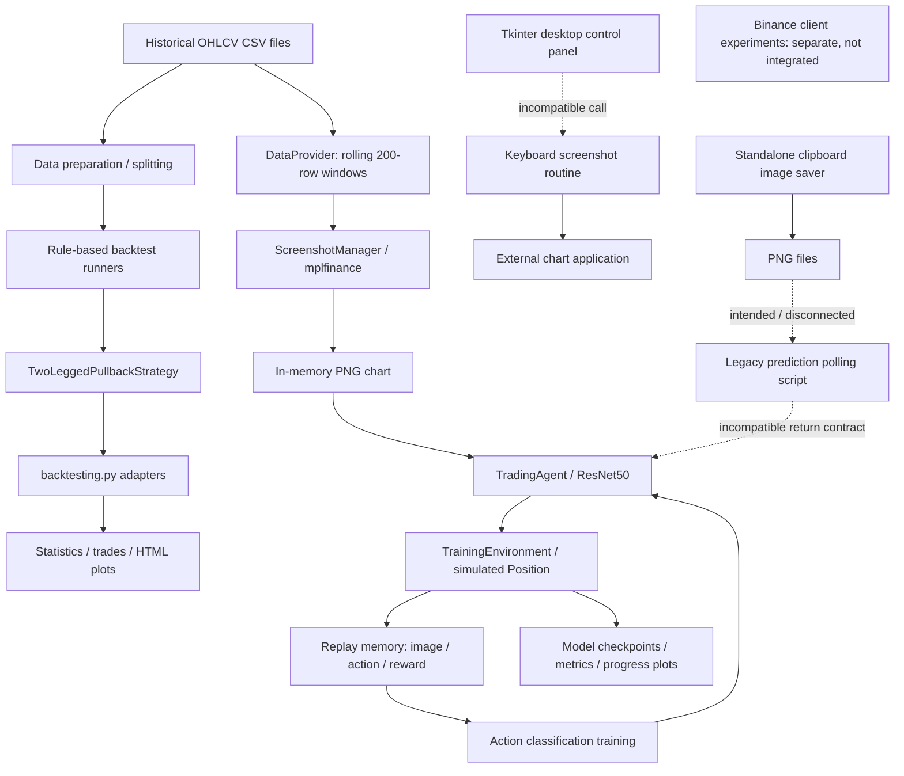

# market-trader architecture

## 1. Purpose and review scope

`market-trader` is a collection of Python trading-research prototypes, primarily
around candlestick/OHLCV data and BTC/USDT examples. It is **not currently one
integrated, deployable trading application**. Three separate workstreams coexist:

1. Rule-based price-pattern detection and historical strategy backtests.
2. A neural agent that classifies chart images and simulates positions.
3. Desktop automation intended to collect chart screenshots.

This describes the checked-in implementation reviewed on 2026-11-01, based on
code at `8398056` (Graphify setup branch). Graphify guided navigation, followed by
static source inspection of all 34 Python files and code cells in both notebooks.
The refreshed graph contains 295 nodes, 533 edges, and 14 communities. Its
inferred links are navigation aids, not proof of working runtime integration.
No training, exchange requests, desktop automation, or backtests were executed.
Consequently, “implemented” below means present in source, not runtime-certified.

## 2. System map

Solid arrows represent relationships implemented in source, not a successful
end-to-end run. Dashed arrows mark intended or incompatible connections. The
training path itself has blocking interface defects listed in section 8.

## 3. Component inventory

### `strategies/`: rule-based research

| File | Responsibility and integration |
| --- | --- |
| [strategy.py](strategies/strategy.py) | Shared `Strategy` protocol, OHLCV `DataFrameRow`, `PredictionResult`, and `TradingAction` enum (`buy`, `sell`, `noAction`). Stops/targets are absolute price levels. |
| [two_legged_pullback_strategy.py](strategies/two_legged_pullback_strategy.py) | Stateful detector: downward movement, first low, bounce, then a second low. Emits BUY or NO_ACTION; no SELL branch is implemented. |
| [backtesting_strategy.py](strategies/backtesting_strategy.py) | Generic `backtesting.py` adapter: converts each bar into a domain row, requests a prediction, opens a position, and checks stored stop/target levels. Includes CSV loading and Plotly output. |
| [backtest_example.py](strategies/backtest_example.py) | Batch runner over `data/split_clean15/week_*.csv`; saves per-chunk statistics, trades, and summaries; attempts aggregate reporting. |
| [run_backtest.py](strategies/run_backtest.py) | Alternative, pullback-specific adapter using `CsvLoaderCandlestickChart`; sends BUY/SELL signals to `backtesting.py` but does not use the predicted stop/target. |
| [csv_loader_candlestickchart.py](strategies/csv_loader_candlestickchart.py) | Requires `datetime, open, high, low, close, volume`; parses/sorts datetime and coerces numeric columns. Does not set datetime as the index. |
| [test_csv_loader.py](strategies/test_csv_loader.py) | Manual loader inspection script using `../data/dev.csv`; prints data/dtypes rather than asserting behavior. |
| [backtesting_simple.py](strategies/backtesting_simple.py) | SMA crossover demo using library GOOG data. Contains a stale no-argument pullback prediction call and executes a backtest at import time. |
| [patterns/trend_classification.py](strategies/patterns/trend_classification.py) | EMA and linear-regression trend experiment. Public method signatures and its example caller are inconsistent. |
| [candlestick_pattern_analyzer.py](strategies/candlestick_pattern_analyzer.py) | Standalone engulfing/doji/hammer/shooting-star detection with RSI and a MACD-like calculation; emits a separate `TradingDecision` DTO. Not wired into backtest runners or the neural agent. |
| [json_serialization.py](strategies/json_serialization.py) | Standalone `Trade` dataclass and JSON round-trip demonstration; not the simulator's position/ledger model. |
| `__init__.py` | Package marker; no orchestration. |

The pullback strategy keeps four recent candles and a growing full candle
history. It uses 0.3% movement and 0.2% bounce thresholds. A completed pattern
places the stop 0.2% below the second low and the target at twice the entry-to-stop
distance. The optional trend-analyzer helper is not called by the main prediction
path. Pattern state stores sliding-window indices without consistently rebasing
them, so its cross-window behavior needs verification.

### `agent/`: chart-image model and simulation

| File | Responsibility and integration |
| --- | --- |
| [train.py](agent/train.py) | Training entry script; locates BTCUSDT train/validation CSVs under `backtester/data/btc/5min`, runs four episodes of up to 400 steps, then plots progress. |
| [training_environment.py](agent/training_environment.py) | Main coordinator: providers, rendered charts, model inference, simulated position exits, replay sampling, validation, metrics, early stopping, and checkpoint selection. |
| [model.py](agent/model.py) | `TradingModel` neural architecture and `TradingAgent` wrapper for preprocessing, prediction, optimizer/scheduler, training, and checkpoint loading/saving. |
| [screenshot_manager.py](agent/screenshot_manager.py) | In-memory LRU PNG cache over chart windows; delegates rendering to `backtester.plot_candlesticks`. |
| [metrics.py](agent/metrics.py) | Tracks completed trades, returns, durations, win rate, Sharpe/Sortino-style ratios, and exit reasons. Its action encoding disagrees with the model/environment. |
| [early_stopping.py](agent/early_stopping.py) | Stateful patience-based validation-loss stopping helper. |
| [performance_profiler.py](agent/performance_profiler.py) | Optional timing/CPU context manager and statistics writer; also exposes a separate CPU monitoring thread API. Disabled by default in the environment. |
| [predict.py](agent/predict.py) | Polls a screenshot directory, selects a latest checkpoint and image, and prints predictions. Caller expects an obsolete two-value return instead of the current prediction dictionary. |
| [binance_client.py](agent/binance_client.py) | Minimal Binance imports and API credential-variable setup; no operational exchange adapter. |
| [binance_client_tester.ipynb](agent/binance_client_tester.ipynb) | Separate client/price-query experiment with threshold/quantity settings. Does not establish a connected order-execution pipeline. |
| `readme.txt` | Empty file in this snapshot. |

**Model input/output:** PNG bytes or an image path → RGB → resize to 224×224 →
ImageNet normalization → ResNet50 features → residual fully connected blocks
(512, 256, 128, 64) → action, confidence, and long/short stop/target heads.
ResNet BatchNorm layers are replaced with GroupNorm; most backbone parameters
are frozen. Constructing the model requests default pretrained weights, which
may download if not already cached. CUDA is used when available, otherwise CPU.

`TradingAgent.predict()` returns a dictionary containing `should_trade`, action
`0=long` / `1=short` (or `None` when gated out), action/position confidence, and
four stop/target percentage values. This is separate from the rule-based
`PredictionResult` contract; there is no common strategy adapter between them.

**Training intent versus implementation:** the environment stores image/action/
reward tuples and simulates outcomes, giving it the appearance of reinforcement
learning. However, `train_step()` only uses an action-classification loss. The
sampled reward is discarded, and labels come from the agent's own actions rather
than a demonstrated market-outcome target. Confidence and stop/target heads have
no direct loss in this training routine. This is not an implemented
reward-optimized RL algorithm.

### `backtester/` and `data/`: data utilities, not one backtest engine

| File | Responsibility and integration |
| --- | --- |
| [data_provider.py](backtester/data_provider.py) | Loads lowercase OHLCV columns; yields a 200-row window advancing one bar per call; computes SMA20/50, RSI14, MACD and signal values. Also includes a separate equity-command simulator not used by the environment's `Position` loop. |
| [plot_candlesticks.py](backtester/plot_candlesticks.py) | Renders the latest candles with EMA20/50/100/200 using mplfinance/Matplotlib, returning PNG bytes. Chart title is hard-coded to BTC-USDT/5min. |
| [resample_data.py](backtester/resample_data.py) | Aggregates Binance-style `open_time` data and volume/trade fields into five-minute OHLCV rows; example paths are Windows-specific. |
| [data/split_data.py](backtester/data/split_data.py) | Assigns whole timestamp-based weeks to shuffled train/validation/test subsets (default 70/20/10, seed 42), then sorts each subset and writes three CSVs. |
| [../data/split_csv.py](data/split_csv.py) | Splits `data/clean15.csv` into weekly files for the rule-based batch runner; drops the datetime index when writing. Runs on import. |
| [backtestLib.py](backtester/backtestLib.py) | Legacy `Backtester` stub: stores data, prints buy/sell, returns essentially unchanged equity. Not the engine used by the rule-based runners or current training simulation. |
| [backtest.ipynb](backtester/backtest.ipynb) | Despite its name, contains CUDA availability/allocation checks, not a backtest workflow. |
| `__init__.py` | Empty package marker. |

Training uses **synthetic chart images rendered from CSV**, not desktop captures.
The indicators calculated by `DataProvider` are not passed as a numerical feature
vector to the model; the renderer uses OHLCV and calculates its own EMAs.

### `resourceGathering/`: separate desktop automation prototype

| File | Responsibility and integration |
| --- | --- |
| [gui.py](resourceGathering/gui.py) | Tkinter `TradingBotGUI`: click-coordinate capture, interval/duration inputs, and start/stop/restart buttons backed by worker threads. |
| [mouse_control.py](resourceGathering/mouse_control.py) | Captures a desktop click location and can move/click at stored coordinates. |
| [keyboard_control.py](resourceGathering/keyboard_control.py) | Sends keyboard shortcuts and left-arrow input to the active desktop application. |
| [screenshot_routine.py](resourceGathering/screenshot_routine.py) | Repeats Ctrl+Alt+S and left-arrow until stopped; depends on an external application's shortcut behavior. Current routine does not call the imported clipboard saver. |
| [clipboard_screenshot.py](resourceGathering/clipboard_screenshot.py) | Standalone clipboard-image-to-timestamped-PNG utility. |
| [stuff.py](resourceGathering/stuff.py) | One-off Parquet-to-CSV conversion with hard-coded Windows paths; runs on import. |

The desktop subsystem requires an interactive display/input environment. It is
not a background data service and is not invoked by training.

## 4. Main flows and entry points

### Rule-based backtests

`data/clean15.csv` → `data/split_csv.py` → weekly CSVs →
`strategies/backtest_example.py` → generic `BacktestingStrategy` → pullback
predictions → third-party `backtesting.Backtest` → result files and plots.

The batch runner reuses one strategy instance across chunks, so its pattern
history can leak between otherwise separate backtests. The generic loader creates
a new one-minute index starting today, rather than preserving the source's actual
timestamps. The alternative `strategies/run_backtest.py` retains a separate
loading/adapter implementation and has a hard-coded developer path.

### Image-agent training (intended; currently blocked)

Train/validation CSVs → `agent/train.py` → `TrainingEnvironment` → rolling
`DataProvider` windows → cached PNGs → `TradingAgent.predict()` → simulated
`Position` → replay memory → action classification updates → validation/checkpoint
selection → files under `saved_models/`.

This route has no connection to a live broker, order book, or exchange execution.
The training `Position` forces a 2:1 take-profit/stop-distance ratio rather than
using the model's take-profit output. A risk setting caps the price stop distance;
it is not an equity-based position-sizing implementation.

### Screenshot prediction (intended; currently incompatible)

External chart application / separately saved PNGs → `agent/predict.py` polling →
checkpoint load → model prediction → console output. There is no implemented
bridge from these predictions to exchange orders.

Entry scripts are listed to explain intent, **not as verified runnable commands**.
Many depend on the working directory, local datasets, and repairs below.

## 5. Data and boundary contracts

| Boundary | Current contract / discrepancy |
| --- | --- |
| Rule-based CSV loader | Requires `datetime` plus lowercase OHLCV; sorts datetime but keeps it as a column. |
| Neural data provider | Requires lowercase OHLCV; does not normalize timestamps into a datetime index. |
| Resampling utility | Expects `open_time` and additional exchange-volume fields; output does not automatically become the split utility's `timestamp` schema. |
| Weekly train/validation split | Expects `timestamp`; concatenated selected weeks can contain time gaps. |
| Rule-based prediction | String-valued action plus absolute stop/target prices. |
| Neural prediction | `0=long`, `1=short`, confidence gate and percentage-valued stop/target fields. |
| Provider equity / trade metrics | `0=close`, `1=long`, `2=short`; incompatible with neural action IDs without translation. |

There is no canonical market-data schema or shared execution/risk interface yet.
These are not merely different names for one interchangeable pipeline.

## 6. Storage, dependencies and deployment

Storage is file-based: input CSV/Parquet, optional captured PNGs, in-memory chart
cache/replay memory, `.pth` model files, logs, result CSV/text, and HTML plots.
There is no application database, HTTP API, queue, scheduler, container definition,
or deployment configuration in this snapshot. The only app UI is the Tkinter
collection tool; HTML plots are generated artifacts, not a hosted service.

No input CSVs are present in this checkout. The repository ignores `*.csv`,
`*.html`, and `*.pyc`; dataset provisioning is external. No requirements file,
`pyproject.toml`, dependency lock, or CI definition is present.

Imports indicate these dependency groups (not tested/pinned installation lists):

- Data/numerics: pandas, NumPy, scikit-learn; pandas-ta in the legacy stub.
- Backtesting/visualization: backtesting.py, Plotly, Matplotlib, mplfinance.
- Model/images: PyTorch, torchvision, Pillow; optional CUDA runtime.
- Profiling: psutil (imported even though environment profiling defaults off).
- Desktop: Tkinter, keyboard, mouse, OS clipboard/display support.
- Exchange experiments: python-binance's `binance.client.Client`.

Paths mix root-relative, parent-relative, Windows and developer-specific Linux
locations. Several modules use script-local imports or manually alter `sys.path`.
This is currently a script-oriented workspace, not an installable application.
API credential declarations in exchange experiments should remain outside shared
architecture examples; no credential values are reproduced here.

## 7. Cross-cutting design observations

- There are multiple trade/position representations: neural `Position`, metrics'
  trade dictionaries, the JSON demo's `Trade`, and library-managed backtest trades.
- Two different simulation styles coexist: third-party backtesting.py and the
  environment's manual equity loop. `DataProvider.calculate_equity()` is a third,
  separate accounting implementation, while `backtestLib.py` is only a stub.
- Broad exception handling sometimes logs and returns zeros/`None`, which can
  make failures look like empty data or neutral performance.
- Screenshot cache keys use only index range and shape, not data/provider identity;
  equal index ranges in train and validation can collide in their shared cache.
- Validation is not an independent market-direction evaluation: targets are the
  currently held position or default long, and `int(1 / subset_size)` gives five
  steps at the default 0.2 rather than 20% of a dataset.

## 8. Confirmed static integration problems

These are source-level findings, not results from executing the system.

| Area | Evidence and consequence |
| --- | --- |
| Training cannot reset an episode | `TrainingEnvironment.reset_equity()` and `validate()` call `DataProvider.reset_to_random_week()`, which does not exist. They also require `week_start`/`week_end` state keys absent from `get_state()`. The training reset occurs before the episode's main exception handler. |
| Exit reward sign | The long stop-loss reward is `1 - stop_price / entry_price`, positive when price stops below entry. The short-side sign reversal likewise makes its stop-loss reward positive. Reported equity/rewards therefore cannot be treated as correct P&L. |
| Action-ID disagreement | Model/environment use 0/1 for long/short; `TradeMetrics.record_action()` interprets 0 as close and 1 as long. Provider accounting separately uses 0/1/2. |
| Risk-unit ambiguity | Prediction outputs percentage points; `Position` divides by 100 only when the number exceeds 1. Values at/below 1 are interpreted inconsistently and then clamped to the risk setting. |
| Learning objective | Reward is ignored during replay updates; only the action head is directly trained. CrossEntropyLoss receives already-softmaxed probabilities rather than raw logits. |
| Prediction script | `decision, minutes = agent.predict(...)` conflicts with the dictionary returned by `TradingAgent.predict()`. |
| Desktop GUI call | GUI passes four positional arguments to `run_screenshot_routine()`, whose signature accepts only interval and optional stop flag. Duration and mouse controller are not implemented in that routine. |
| Generic short exits | `BacktestingStrategy.next()` uses long-side low/high stop/target conditions for both directions. Actual pullback strategy currently emits only BUY, but adding SELL exposes this discrepancy. Stop/target checks also submit position closes rather than native bracket orders. |
| Aggregate results | `save_backtest_results()` expects `stats._trades`; the aggregate caller supplies an ordinary dictionary, causing failure. Summed returns and averaged ratios are also not a reconstructed portfolio equity curve. |
| Legacy demos | SMA demo calls `predict()` without its required candle; trend helper constructs `TrendAnalyzer` without required data, and `determine_trend()` calls `linear_regression_slope()` without required data. |

## 9. Recommended architectural direction (not implemented)

Preserve the distinction between the two research approaches, but share the
market data and simulation contracts:

1. Define one timestamped OHLCV schema and explicit action/price/percentage types.
2. Establish one tested position, risk, and accounting layer before trusting
   performance metrics or training rewards.
3. Make deterministic rule-based backtesting the first reproducible end-to-end
   baseline with a small local fixture and dependency manifest.
4. Adapt the image model to a common strategy interface; decide explicitly
   whether its objective is supervised prediction or reward-based learning.
5. Keep desktop capture and Binance experiments optional adapters, not core
   dependencies of offline research.
6. Add centralized configuration/entry points instead of hard-coded paths.

These are suggested boundaries and priorities, not changes made by this review.

## 10. Maintaining this document

Follow [AGENTS.md](AGENTS.md) and [GRAPHIFY.md](GRAPHIFY.md): query the graph first,
verify relationships in source, and rebuild after code changes. Update this file
when entry points, interfaces, data contracts, or actual integration status change.
Graphify currently omits notebooks/docs; their contents were inspected separately
for this review. Static mapping does not certify strategy correctness or model
quality.
