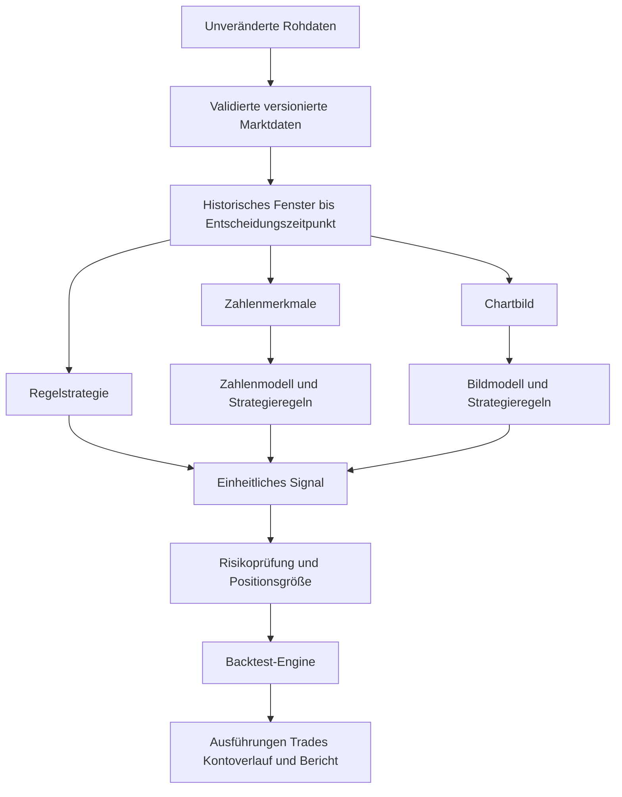

# Roadmap: reproduzierbare Trading-Forschung und Backtests

Stand 2026-11-11 · M4-Strategiewechsel und Pullback-Portierung geprüft

## 1. Ziel und verbindliche Reihenfolge

Das Repository soll eine reproduzierbare Grundlage für historische Backtests
werden. Regelstrategien, Modelle auf Zahlenreihen und Modelle auf Chartbildern
sollen dieselben Daten-, Risiko-, Ausführungs- und Auswertungsverträge verwenden.
Ein späterer Trading-Bot kann auf diesen Grundlagen aufbauen.

Der [Fahrplan für die Modellentwicklung](MODEL_DEVELOPMENT_ROADMAP.md) beschreibt
die nächsten Schritte für verständliche Auswertungen, trainierbare Zahlen- und
Bildmodelle und den gemeinsamen Ablauf für Modellversuche.

Die von Andreas gewünschte Reihenfolge lautet:

1. Roadmap im Repository dokumentieren.
2. Testfälle mit Eingaben, erwarteten Ergebnissen und Abnahmekriterien festlegen.
3. Erst danach die Umsetzung beginnen; je Arbeitspaket zunächst die zugehörigen
   ausführbaren Tests erstellen und anschließend den Produktionscode ergänzen.

Die fachliche Testfallspezifikation steht in [TEST_CASES.md](TEST_CASES.md).
Dokumentierte Testfälle sind noch keine ausgeführten oder bestandenen Tests.
Die fachliche Erstfassung ist abgeschlossen. Das erste ausführbare Testpaket
mit festgelegten Datentypen und anschließender Implementierung der fünf
Datenfunktionen ist in [TESTING.md](TESTING.md) dokumentiert. Ein zweites Paket
ergänzt Normalisierung, Qualitätsberichte und reproduzierbare Kennungen; ein
drittes ergänzt explizite UTC-Sitzungen. Ein viertes prüft angefragte Zeiträume,
Randlücken und vollständig fehlende Serien.
Das fünfte ergänzt lokale Artefakte und Herkunftsmanifeste. Das sechste verbindet
die Datenfunktionen in einem Offline-Ablauf über CLI.

## 2. Ausgangslage

[ARCHITECTURE.md](ARCHITECTURE.md) beschreibt den vorhandenen Code. Der Fortschritt
der Datenbasis und des Offline-Backtests steht in Abschnitt 10. Grundlage der
ursprünglichen Bestandsaufnahme sind
der ursprüngliche Code bei `067dcbed`, scoped Graphify-Abfragen und
statische Quellcodeprüfung. Der lokale Graph umfasst 34 Python-Dateien mit
295 Knoten und 533 Verbindungen. Dokumentation und Notebooks sind nicht indexiert;
die Architekturdokumentation wurde direkt gelesen.

Heute bestehen drei weitgehend getrennte Stränge: regelbasierte Backtests,
bildbasiertes Modelltraining mit eigener Simulation und Desktop-Automatisierung.
Besonders relevant für den Neuaufbau sind mehrere Kontoberechnungen,
unterschiedliche Aktionsnummern und Einheiten, uneinheitliche Zeitstempel sowie
Training auf eigenen Entscheidungen bei verworfenen Rewards.

Markt, Instrument, Handelsplatz und Kerzenintervall bleiben ausdrücklich offen.
Synthetische Beispiele in den Testfällen legen diese Entscheidungen nicht fest.

## 3. Umgang mit dem vorhandenen Code

| Bereich | Geplante Behandlung | Begründung |
| --- | --- | --- |
| `resourceGathering/` | Nach Bestandsaufnahme archivieren und aus dem aktiven Forschungspfad nehmen. | Historische Charts lassen sich aus Marktdaten reproduzierbar rendern. |
| `backtester/backtestLib.py`, alte SMA-Demo, JSON-Demo, CUDA-Notebook und Einmalskripte | Als frühere Experimente erhalten; nicht in den neuen Kern übernehmen. | Stubs, Demonstrationen oder lokale Hilfsskripte bilden keine gemeinsame Laufzeit. |
| Aktuelle `TrainingEnvironment`, Provider-Kontoberechnung und Metrik-Aktionsübersetzung | Als Referenz sichern; durch gemeinsame Verträge und einen verbindlichen Simulationspfad ersetzen. | Grundlegende Widersprüche bei Ergebnissen, Einheiten und Zuständigkeiten. |
| Pullback- und Candlestick-Ansätze | Später als einzelne Strategien portieren und anhand eigener Fälle prüfen. | Wiederverwendbare Forschungsfragen; ein wirtschaftlicher Nutzen ist nicht belegt. |
| Chart-Rendering, Datenfenster und Indikatorideen | Selektiv übernehmen; von Datenbeschaffung und Modelltraining trennen. | Nützliche Verarbeitungsschritte mit klar begrenzbarer Verantwortung. |
| CSV-Loader, Resampling und Split-Skripte | In eine gemeinsame Datenpipeline überführen. | Einheitliche Zeit- und Schemaverträge sind erforderlich. |
| Profiling und weitere Hilfsfunktionen | Bei konkretem Bedarf übernehmen. | Sie sind keine Voraussetzung für einen überprüfbaren ersten Backtest. |

Vor einem späteren Verschieben oder Entfernen werden Referenzen, vorhandene
Datensätze und Modellartefakte inventarisiert. Die bisherige Arbeit bleibt über
Git nachvollziehbar. Legacy-Code wird nicht automatisch importiert oder ausgeführt.

## 4. Zielarchitektur und Verantwortlichkeiten

Für den Start genügt ein Python-Paket mit CLI und lokaler Dateispeicherung.



| Geplantes Modul | Verantwortung | Grenze |
| --- | --- | --- |
| `domain` | Datentypen und Verträge für Instrument, Kerze, Signal, Order, Ausführung und Ergebnis. | Keine Datenanbieter-, Modell- oder Engine-Abhängigkeiten. |
| `data` | Import, Anbieteradapter, Validierung, Normalisierung, Resampling und Datensatzmetadaten. | Keine Handelsentscheidungen oder Kontoberechnung. |
| `representations` | Historische Fenster in Zahlenmerkmale oder Chartbilder umwandeln. | Keine zukünftigen Informationen oder Orderausführung. |
| `models` | Offline trainieren, Artefakte speichern/laden und Vorhersagen erzeugen. | Keine eigene Handelsbuchhaltung; Inferenz verändert das Modell nicht. |
| `strategies` | Informationen und gegebenenfalls Vorhersagen in Handelssignale übersetzen. | Keine eigene Ausführung, Kontoführung oder Datenbeschaffung. |
| `risk` | Zulässigkeit, Positionsgröße und Risikovorgaben aus Signal und Kontozustand ableiten. | Keine erfundenen Ausführungspreise; keine zweite Kontoberechnung. |
| `backtesting` | Zeitablauf, Ausführungen, Positionslebenszyklus und verbindlichen Kontoverlauf simulieren. | Fachliche Strategien kennen die konkrete Engine nicht. |
| `experiments` / `reporting` | Konfiguration, Laufmetadaten, Ergebnisexport und Vergleich organisieren. | Ergebnisse aus Ausführungen und Kontoverlauf ableiten. |

Der Engine-Adapter darf die Buchhaltung einer Bibliothek verwenden. Entscheidend
ist eine verbindliche Quelle für Positionen und Kontowerte; ein zweites,
abweichendes Ledger im Risikomodul oder Modell wird nicht eingeführt.

### Gemeinsame Verträge

- Instrumentmetadaten beschreiben Marktart, Währung, Mengen-/Preisraster und
  unterstützte Fähigkeiten. Nicht unterstützte Einstellungen erzeugen einen
  verständlichen Fehler.
- Kerzen enthalten echte UTC-Zeitstempel für Beginn, Ende und Verfügbarkeit,
  Instrument, Intervall und OHLCV. Volumen und Mengen dürfen Nachkommastellen haben.
- Signale unterscheiden explizit Einstieg Long, Einstieg Short, Ausstieg und
  unverändert. Unverändert bedeutet keine Änderung einer bestehenden Position.
- Absolute Stop-/Zielpreise und relative Abstände erhalten unterschiedliche
  Felder. Einheiten werden nicht aus der Größenordnung einer Zahl erraten.
- Die Strategie erhält nur zum Entscheidungszeitpunkt verfügbare Informationen
  und einen definierten Kontozustand. Jeder Lauf erhält einen frischen Zustand.
- Training ist ein separater Vorgang. Der Backtest verwendet ein festgelegtes,
  mit Metadaten versehenes Modellartefakt.

### Erweiterbare Strategien

Strategien werden unter einem eindeutigen Namen registriert und über eine
validierte Konfiguration samt Parametern ausgewählt. Eine neue Strategie erfordert
eine Implementierung, ihre Registrierung und eigene Tests; der Engine-Code
bleibt unverändert. Historienbedarf und unterstützte Fähigkeiten sind explizit.
Eine interne Registrierung genügt zunächst. Externe Plugin-Pakete sind eine
spätere Erweiterung bei tatsächlichem Bedarf.

## 5. Entscheidungen vor dem jeweiligen Umsetzungsschritt

| ID | Entscheidung | Zeitpunkt / aktueller Stand |
| --- | --- | --- |
| D-01 | Erster Markt, Instrument, Handelsplatz und Zeitintervall; verfügbare historische Daten. | Offen. Vor erstem echten Anbieteradapter und marktbezogenen Ergebnissen entscheiden. Dateiimport und synthetische Tests sind vorher möglich. |
| D-02 | Backtest-Engine und benötigte Fähigkeiten. | Für R0 festgelegt. Ein lokaler Kerzensimulator führt Ausführungen und Konto gemeinsam. Der [Engine-Vergleich](BACKTEST_CONTRACT.md) dokumentiert die Abweichungen bei der geprüften Bibliothek. |
| D-03 | Ausführungsprofil für Orders, Zeitpunkt, Kosten, Rundung, Intrabar-Regeln und Laufende. | Für R0 im [Backtest-Vertrag](BACKTEST_CONTRACT.md) festgelegt. |
| D-04 | Modellziel, Vorhersagehorizont, Auswahlverfahren und zeitliche Datensplits. | Der GER30-Pilot verwendet 30 Minuten Bruttokursrendite und chronologische Abschnitte mit bereinigten Grenzen. Ein Ridge-Modell mit festem Alpha wird anhand von MAE und RMSE auf der Validierung gegen eine Nullvorhersage geprüft. [Datensatzvertrag](TRAINING_DATA_CONTRACT.md) |
| D-05 | Handelssitzungen, Zeitstempelzuordnung und Regeln für Lücken/unvollständige Kerzen. | Vor marktbezogener Datenverarbeitung entscheiden; Tests nutzen einen expliziten synthetischen Kalender. |
| D-06 | Unterstützte Python-Version, Dependency-Werkzeug und optionale Abhängigkeiten. | Für das erste Testpaket festgelegt: CPython 3.14, uv mit Lockfile, pytest 9.2.0 laut Lockfile; keine externen Kernabhängigkeiten. Modell-/Bildabhängigkeiten folgen separat. |

Die Engine-Entscheidung gilt für das synthetische Profil R0 mit einer Serie und
einer Position. Marktbezogene Fähigkeiten werden nach D-01 bewertet.

## 6. Daten und reproduzierbare Experimente

### Datenpipeline

1. Rohdaten unverändert lokal ablegen und Herkunft, Abfrageparameter sowie
   Abrufzeitpunkt dokumentieren. Dateiimport ist der erste Zugang.
2. In ein gemeinsames Schema normalisieren; Zeitzone, Instrument und Intervalle
   ausdrücklich zuordnen. Dubletten, Konflikte, Lücken und ungültige Werte melden.
3. Geprüfte Daten als versionierte lokale Datensätze speichern. Eine Kennung
   berücksichtigt Inhalt und Verarbeitungskonfiguration.
4. Resampling, Merkmale und Charts daraus ableiten. Unvollständige Kerzen und
   geschlossene Handelssitzungen folgen dokumentierten Regeln.
5. Externe Downloads nach D-01 ergänzen: Pagination, begrenzte Wiederholungen,
   Wiederaufnahme und erneuter Import dürfen keine unbemerkten Konflikte erzeugen.

Kleine synthetische Testdaten gehören ins Repo. Große Rohdaten, erzeugte Bilder,
Modelle und Laufartefakte bleiben lokal; Beschaffung und Herkunft sind dokumentiert.
Ein Beispiel-Backtest muss nach der Installation ohne Konto, API-Schlüssel,
Netzwerkzugriff oder GPU ausführbar sein.

### Informationsverfügbarkeit und Modellvergleich

Features und Bilder enthalten ausschließlich zum Entscheidungszeitpunkt
verfügbare Daten. Beim Referenzprofil entsteht ein Signal nach Kerzenschluss;
eine Marktorder wird frühestens zur nächsten Kerzeneröffnung ausgeführt.

Training, Validierung und abschließender Test werden zeitlich getrennt.
Trainingsbeispiele, deren Zielhorizont in den nächsten Abschnitt reicht, werden
an der Grenze entfernt. Gelernte Skalierung und Merkmalsauswahl werden nur auf
Trainingsdaten angepasst. Ein abschließender Testabschnitt bleibt bis nach der
Modell-/Parameterauswahl unberührt. Zeitlich geordnete Prüfungen beschreibt auch
die [TimeSeriesSplit-Dokumentation](https://scikit-learn.org/stable/modules/generated/sklearn.model_selection.TimeSeriesSplit.html).

Zahlen- und Bildmodell erhalten dieselben Informationsgrenzen, Zieldefinitionen
und Auswertungszeiträume. Vorhersagegüte und Handelsergebnis werden getrennt
ausgewiesen. Lernen aus eigenen Aktionen ohne unabhängiges Ziel wird nicht als
Nachweis eines brauchbaren Lernverfahrens übernommen.

### Laufartefakte

Jeder Lauf speichert Konfiguration, Strategieparameter, Codeversion einschließlich
Änderungsstatus, Datensatzkennung, Ausführungs-/Kostenprofil, Abhängigkeitsstand,
Zufallsseed und gegebenenfalls Modell-/Renderer-Version. Ausführungen, Trades,
offene Positionen und Kontoverlauf müssen sich gegenseitig erklären.

## 7. Meilensteine und Abnahmekriterien

| Meilenstein | Inhalt | Fertig, wenn ... |
| --- | --- | --- |
| M0 – Roadmap | Ausgangslage, Grenzen, Migration und Reihenfolge dokumentieren. | Roadmap liegt im Repo; Plan und vorhandene Architektur sind unterscheidbar. |
| M1 – Testfälle vor Umsetzung | Fachliche Fälle, erwartete Werte, Prioritäten und offene Profilentscheidungen beschreiben. | TEST_CASES.md deckt M2–M6 ab; für den nächsten Meilenstein sind die Erwartungen eindeutig. Noch keine bestandenen Tests behaupten. |
| M2 – Projekt- und Datenbasis | Abhängigkeiten, Installation, Testgerüst, gemeinsame Datenverträge, Dateiimport, Validierung, Resampling und kleine Fixtures. | Frischer Checkout lässt sich dokumentiert einrichten; Daten-/Zeitverträge sind durch ausführbare Tests geprüft; der Kern benötigt keine Modellbibliotheken. |
| M3 – Verbindlicher Backtest | Engine auswählen, Adapter, Risiko, Kosten, Positionen, Kontoverlauf und Ergebnisexport implementieren. | Handgerechnete Fälle bestehen; ein Beispiel läuft offline über CLI; Kontowerte und Trades stimmen überein. |
| M4 – Strategien und echte Daten | Registry, Parameterprüfung, Referenzstrategie, zweiter Regelansatz; ausgewählten Altansatz portieren; ersten Anbieteradapter nach D-01 ergänzen. | Strategiewechsel erfolgt per Konfiguration; Zustände sind isoliert; Datenimport ist wiederholbar; Vergleich verwendet dasselbe Ausführungsprofil. |
| M5 – Zahlenmodell | Ziel und Splits festlegen; Training, Artefakte und Inferenz integrieren. | Zeitliche Trennung und Artefaktverträge sind geprüft; ein eingefrorenes Modell läuft durch denselben Backtest wie Regeln. |
| M6 – Bildmodell | Deterministische Charts, getrennte Caches und Bildmodell ergänzen. | Daten-/Cache-Grenzen sind geprüft; Zahlen- und Bildansatz sind unter vergleichbaren Bedingungen auswertbar. |

M2 folgt auf M1. Vor der Produktionsimplementierung jedes weiteren Arbeitspakets
werden dessen Fälle in ausführbare Tests übersetzt und ihr anfänglicher Fehler
nachgewiesen. Ein Test muss am vorgesehenen Verhalten scheitern; ein fehlender
Import allein belegt keinen fachlichen Test. Danach wird der kleinste passende
Produktionscode ergänzt und geprüft. API-Details werden vor den jeweiligen Tests
festgelegt, ohne bereits die Fachlogik zu implementieren.

Ein Meilenstein gilt erst als abgeschlossen, wenn die zugehörigen Pflichtfälle
ausgeführt und bestanden sind. Nicht unterstützte Fähigkeiten werden ausdrücklich
abgewiesen und nicht als erfolgreich getestet markiert. Nach Codeänderungen wird
Graphify gemäß AGENTS.md lokal aktualisiert und der betroffene Bereich abgefragt.

## 8. Offline-Backtest

Der Ablauf verbindet Dateiimport, validierte Kerzen, eine vorgegebene Strategie,
Risikoprüfung, simulierte Ausführungen und einen JSON-Bericht.

```text
market-trader backtest --config configs/backtest-example.toml
```

Abnahme: Ein frischer Checkout lässt sich mit den dokumentierten Schritten
einrichten; Tests und Beispiel laufen ohne zusätzliche lokale Daten. Ein zweiter
Lauf liefert dieselben fachlichen Ergebnisse. Jede Veränderung des Kontowerts
lässt sich aus Marktpreisen, Positionen und Kosten erklären.

## 9. Spätere Arbeit und Pflege

Live-Orders, Paper Trading mit externem Dienst, Reinforcement Learning,
Portfoliohandel über mehrere Instrumente und eine neue Benutzeroberfläche sind
spätere Erweiterungen. Ihre Fähigkeiten werden nicht durch den ersten Offline-
Backtest als umgesetzt vorausgesetzt.

ROADMAP.md beschreibt Reihenfolge und Zielzustand; TEST_CASES.md beschreibt
erwartetes Verhalten; ARCHITECTURE.md beschreibt die tatsächlich vorhandene
Implementierung. Bei Änderungen werden die Dokumente entsprechend ihrer Rolle
gepflegt. Dokumentation ist nicht im aktuellen Codegraphen enthalten.

## 10. Aktueller Fortschritt

- M0: Roadmap liegt im Repo.
- M1: 69 fachliche Testfall-IDs sind spezifiziert. Das ursprüngliche Paket mit
  48 Varianten wurde vor der Implementierung um Randfälle ergänzt. Nicht jede
  fachliche ID ist bereits vollständig automatisiert.
- M2: Projekt-/Testgerüst, CSV-Fixture und [Datenvertrag](DATA_CONTRACT.md) liegen
  vor. CSV-Import, Validierung, Resampling, historische Fenster und numerischer
  Referenzmittelwert sind umgesetzt. Das zweite Paket ergänzt Sortierung,
  Deduplizierung mit Konfliktabweisung, Qualitätsberichte und Inhaltskennungen
  getrennt nach Instrument und Intervall. Das dritte Paket ergänzt explizite
  UTC-Sitzungskalender mit Gültigkeitsbereich, Sitzungsraster und Prüfung aktiver
  Lücken. Das vierte Paket ergänzt angefragte Datenzeiträume mit Randlücken,
  erwarteter Kerzenzahl und vollständig fehlenden Instrument-/Intervallserien.
  Das fünfte speichert und lädt lokale Artefakte mit Herkunft, Verarbeitungsversion,
  Integritätsprüfung und unveränderten Originalzeilen. Das sechste ergänzt den
  Offline-Datenablauf über CLI. Insgesamt bestehen 297 Prüfungen.
  Die [M2-Abnahmeprüfung](TESTING.md#m2-abnahmeprüfung) belegt den Datenumfang.
  Der Git-Checkout-Nachweis setzt einen Commit der Arbeitsdateien voraus.
- M3: Der [R0-Simulator](BACKTEST_CONTRACT.md) verarbeitet eine Serie mit
  Schutzorders, Spread, Slippage, Gebühren, risikobasierter Positionsgröße,
  optionaler Endschließung und Drawdown. Der Offline-Befehl gibt einen
  reproduzierbaren Bericht aus.
- M4: Die interne Registry verbindet `single_long`, `sma_crossover` und den
  portierten `two_legged_pullback` mit validierter TOML-Konfiguration und
  frischen Strategieinstanzen. Der Offline-Backtest akzeptiert geprüfte
  Datensatzartefakte samt Sitzungskalender. Der lokale GER30-Pilot wurde mit
  allen drei Strategien ausgeführt. Insgesamt bestehen 375 Prüfungen. Ein
  externer Anbieter und ein handelbares Produkt bleiben für D-01 offen.
- M5: Der erste [überwachte Datensatz](TRAINING_DATA_CONTRACT.md) enthält 375
  Beispiele aus 15 GER30-Sitzungen, aufgeteilt in 200 Training, 75 Validierung
  und 100 Test. Das CPU-Ridge-Modell und seine Skalierung werden nur mit den
  Trainingszeilen angepasst. Der lokale Bericht speichert die Modellparameter
  und vergleicht die Validierungsfehler mit einer Nullvorhersage. Auf dem
  abschließenden Testabschnitt waren MAE und RMSE der Nullvorhersage niedriger.
  Die Strategie `ridge_long` lädt den gespeicherten Bericht und führt
  Signale im R0-Simulator aus. Synthetische Fälle prüfen Merkmale, Zeitgrenzen,
  Kosten und P&L. Der lokale Handelsvergleich auf 14 weiteren GER30-Sitzungen
  verwendet dieselbe feste Menge und dieselben Ausführungskosten für Ridge
  und SMA. Die Berichte erfassen auch den Einfluss von Positionen über Nacht.
- M6: noch nicht begonnen.

Das Normalisierungspaket wurde zuerst mit 39 fehlgeschlagenen Verhaltensprüfungen
vorbereitet und anschließend implementiert. Das Kalenderpaket folgte mit 46
zunächst roten und anschließend grünen Prüfungen, ohne einen konkreten Markt
vorwegzunehmen. Das Zeitraum-Paket wurde mit 47 zunächst roten und anschließend
grünen Prüfungen ergänzt. Der Kalender-Gültigkeitsbereich allein ist keine
Datenanforderung: Ein ausdrücklicher Auftrag ermöglicht die Vollständigkeitsprüfung;
ohne ihn werden keine Lücken außerhalb der beobachteten Historie behauptet.
Das Speicherpaket wurde mit 55 roten Prüfungen vorbereitet; zwei Unicode-
Regressionen und die ausdrückliche Verarbeitungsversion wurden vor der Korrektur
ebenfalls rot geprüft. Alle 57 Varianten sind jetzt grün.
Der Offline-Datenablauf importiert mit einer versionierten Beispielkonfiguration
die synthetische Fixture, erstellt automatisch einen Herkunftsnachweis und
veröffentlicht ein geprüftes Artefakt. Der R0-Beispiellauf und die
handgerechneten Kontofälle sind geprüft. Die beiden Beispielstrategien lassen
sich mit denselben Daten und demselben Ausführungsprofil vergleichen.
D-01 bleibt vor dem ersten Anbieteradapter zu entscheiden.
